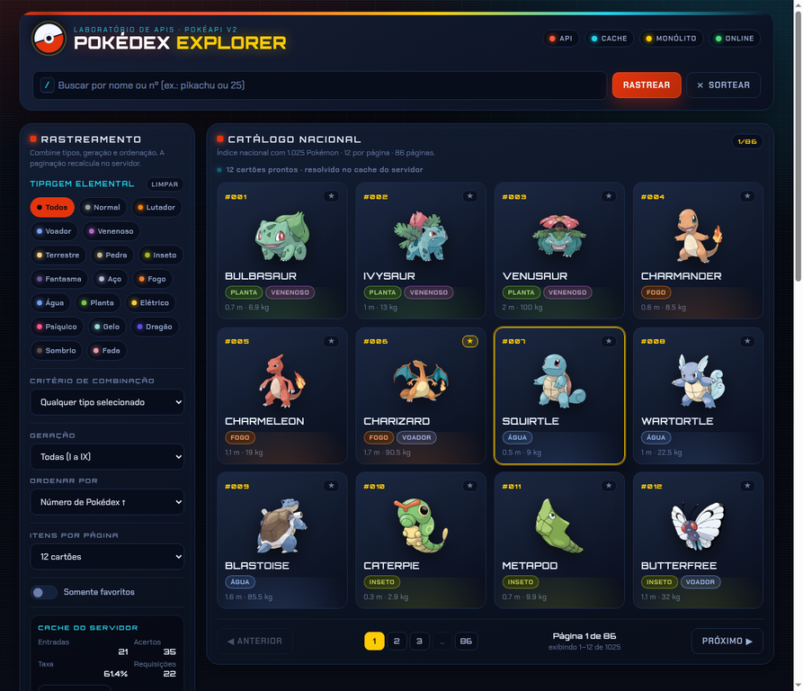
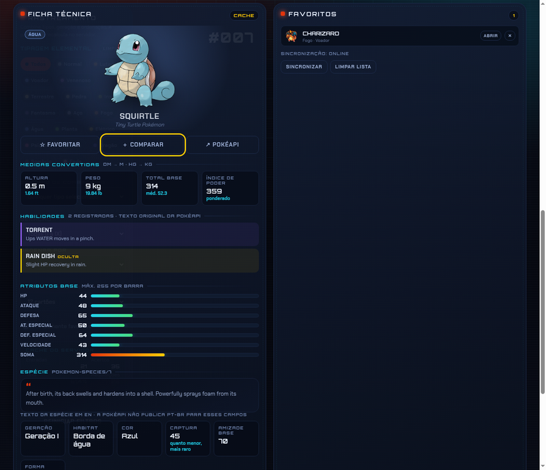
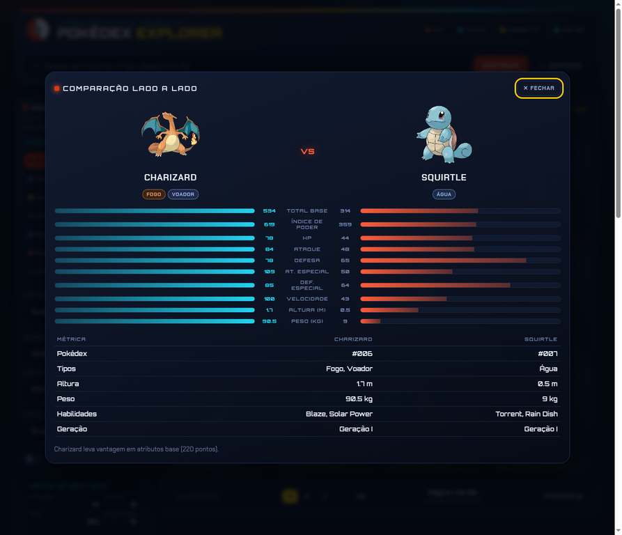
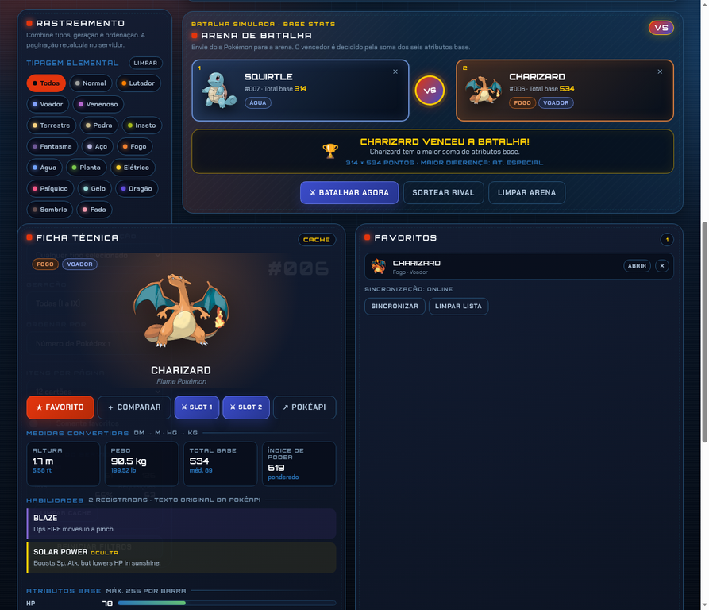

# Pokédex Explorer — Laboratório de APIs (PokéAPI v2)

Web app completo para a atividade **“Pokédex Explorer Web App”**
(enunciado: <https://senaiba.my.canva.site/pokapi>), entregue com **frontend temático Pokémon
próprio** (nada aproveitado do visual claro do site de referência) e **filtragem por todos os
18 tipos**, além dos 4 botões demonstrados no material.

```
Frontend (HTML/CSS/JS puro)  →  Node.js + Express  →  PokéAPI v2  (somente HTTP GET)
        :3000/public                 /api                    pokeapi.co
```

## Resultado em números

| Item | Valor |
|---|---|
| Atividades do enunciado cobertas | **20/20** |
| Testes automatizados | **73** (`npm test`) — 26 unitários + 47 de API, offline |
| Verificações de smoke | **37/37** no monólito e **37/37** no modo microsserviços |
| Endpoints REST | 20 rotas sob `/api` com envelope único `{ok,data,meta}` |
| Filtros de tipo | **18 tipos** + combinação qualquer/todos + geração I–IX + ordenação + tamanho de página |
| Linhas de código (sem fixtures) | ~5.000 em 44 arquivos |

## Início rápido

```bash
npm install
npm start          # → http://localhost:3000   (arquitetura inicial: monólito)
npm test           # 73 testes automatizados
npm run smoke      # 37 verificações contra o servidor que está rodando

npm run micro      # → http://localhost:4000   (desafio: microsserviços + API Gateway)
```

Requisitos: Node.js 18.17+ e acesso à PokéAPI para uso normal (os testes não precisam de rede).

## O que dá para fazer na interface

- **Buscar** por nome (`pikachu`) ou número (`25`), com autocomplete e tolerância a acentos/hífens.
- **Filtrar por tipo**: 18 chips coloridos, selecionando vários de uma vez, com critério
  *qualquer tipo selecionado* (união) ou *todos os tipos selecionados* (interseção) —
  Fogo + Água com “todos” devolve exatamente Volcanion.
- **Filtrar por geração** (I a IX), **ordenar** por número/nome e escolher **6/12/24/36** cartões
  por página; paginação, total de páginas e offsets são recalculados **no servidor**.
- **Ver a ficha completa**: arte oficial, tipos, altura/peso convertidos (decímetros→metros,
  hectogramas→quilogramas, pés/libras), habilidades com descrição (e marcação de oculta),
  seis atributos com barras percentuais, total base, média e índice de poder.
- **Espécie e evolução**: texto da PokéAPI, geração em português, habitat/cor/forma traduzidos,
  grupos de ovo, captura, amizade e a cadeia evolutiva com gatilhos (“Nível 16”, “Nível 36”,
  “Troca”, “Use Pedra do Fogo”…), cada estágio clicável.
- **Comparar** dois Pokémon lado a lado com barras espelhadas, números por atributo e veredito.
- **Batalhar** na Arena de Batalha: envie dois Pokémon para os slots, execute o confronto e veja
  o vencedor pelos seis base stats (HP, Ataque, Defesa, At. Especial, Def. Especial e Velocidade),
  com prioridade por velocidade, tipos, efetividade elemental, críticos, variação de dano e
  pontuação total. Também há sorteio de rival e limpeza da arena. A simulação possui golpes
  elementais, projéteis, flash de impacto, dano flutuante, barras de HP e log narrado — uma
  apresentação inspirada na Pokédex do anime.
- **Favoritar** pelo cartão ou pela ficha, com persistência **no backend** (`data/favorites.json`)
  e espelho no navegador; indicador de sincronização e botão “somente favoritos”.
- **Sortear** um Pokémon (respeitando os filtros ativos) e abrir a ficha direto na PokéAPI.
- **Observar o cache**: entradas, acertos, taxa e requisições, com botão para limpar.

## Como o app se apresenta

Tema próprio (“Terminal PokéTech”), com catálogo paginado, painel de filtros por tipo e ficha técnica
completa em uma única tela.









## Documentação

| Documento | Conteúdo |
|---|---|
| [`docs/00-requisitos-do-enunciado.md`](docs/00-requisitos-do-enunciado.md) | checklist lido do site Canva: 20 atividades, arquitetura exigida, 4 grupos de testes e rubrica |
| [`docs/01-arquitetura.md`](docs/01-arquitetura.md) | diagramas, camadas, estratégias de dados e comparação com o modelo de referência |
| [`docs/02-endpoints.md`](docs/02-endpoints.md) | referência de todas as rotas, parâmetros, exemplos e códigos de erro |
| [`docs/03-como-rodar.md`](docs/03-como-rodar.md) | instalação, modos, variáveis de ambiente, roteiro de demonstração e troubleshooting |
| [`docs/04-testes.md`](docs/04-testes.md) | suíte automatizada, matriz requisito × teste e resultados obtidos |
| [`docs/05-matriz-atividades.md`](docs/05-matriz-atividades.md) | cada uma das 20 atividades → onde está na UI, qual rota atende, como foi validada |
| [`docs/06-vercel.md`](docs/06-vercel.md) | adaptação serverless, deploy, verificação da API e solução de erros de conexão |

## Estrutura

```
pokedex-explorer/
├── server/          # Express: rotas, serviços, gateway interno, cache, cliente da PokéAPI
│   ├── core/        # pokeapi-client (GET + timeout + retry), cache TTL, envelope, erros
│   ├── middleware/  # api-gateway (interno) e tradutor central de erros
│   ├── routes/      # catálogo, pokémon, favoritos, health/cache
│   ├── services/    # 7 serviços de domínio
│   └── utils/       # unidades, tipos PT-BR/gerações, glossário PT
├── public/          # frontend temático (HTML + CSS + JS puro, sem build)
├── gateway/         # API Gateway real dos microsserviços (:4000)
├── services-ms/     # catalog (:4001), stats (:4002), favorites (:4003)
├── scripts/         # run-microservices.js, smoke.js
├── tests/           # unit + api (supertest) + fixtures offline da PokéAPI
├── data/            # favorites.json (persistência do serviço de favoritos)
└── docs/            # 6 documentos do projeto
```

## Decisões que interessam à avaliação

1. **O navegador nunca fala com a PokéAPI.** Tudo passa por `/api`; o backend agrega espécie +
   evolução + ficha em uma única resposta.
2. **Nada é calculado no cliente quando deveria estar no servidor.** Páginas, totais, filtros por
   tipo/geração e ordenações vêm prontos da API — inclusive o `meta.filters` para conferência.
3. **Uma busca de índice, não 1025.** `GET /pokemon?limit=1025` fica em cache por 1 h; filtros por
   tipo usam `GET /type/{tipo}`; apenas os itens da página são hidratados, com concorrência limitada.
4. **Dois modos com o mesmo contrato.** Monólito e microsserviços devolvem o mesmo envelope e os
   mesmos cabeçalhos; trocar de arquitetura é trocar a porta-base do frontend.
5. **Falhas são previsíveis.** 400/404/422/502 com código estável, retries em 5xx/timeout e
   mensagens amigáveis na interface — sem stack no cliente.
6. **Acessibilidade real.** Landmarks, `aria-live` no status, `aria-pressed` nos chips de tipo,
   cartões focáveis com Enter/Espaço, atalhos `/`, `R`, `←`/`→` e `Esc`, foco visível e
   texto alternativo em todas as imagens.

## Tema visual

“**Terminal PokéTech**”: paleta inspirada na Pokédex — vermelho de captura, azul de dispositivo,
amarelo de destaque e azul profundo de batalha — com fundo grafite, scanlines e brilho radial,
cabeçalho com meia Poké Ball,
tipografia *Orbitron* (títulos) + *Chakra Petch* (corpo), cartões com moldura na cor do tipo primário,
chips nas cores oficiais dos jogos, botões com cantos chanfrados, animações de varredura nos
skeletons e anel de carregamento estilo Poké Ball. Todas as fontes têm *fallback* do sistema e as
imagens vêm dos CDs de sprites da própria PokéAPI.

## Licença e fonte dos dados

[MIT](LICENSE). Dados e artes: [PokéAPI v2](https://pokeapi.co) e seu repositório de sprites
(GitHub `PokeAPI/sprites`). Projeto educacional, sem fins comerciais.
